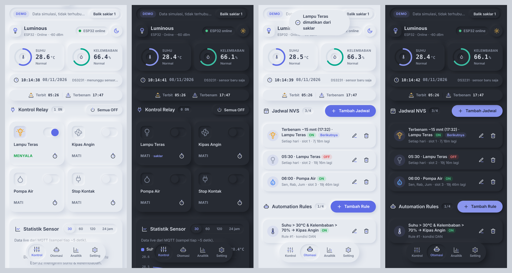
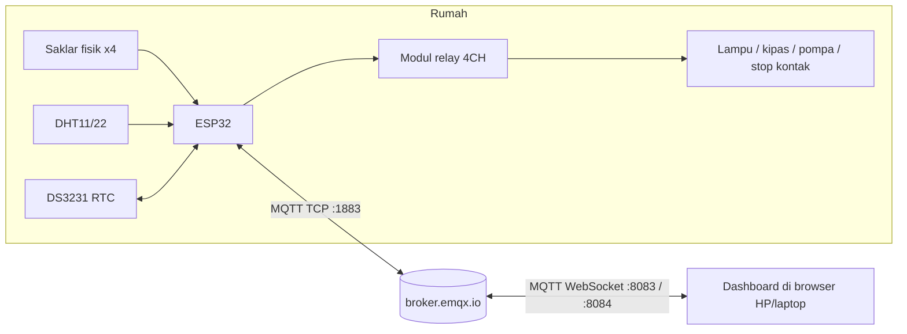
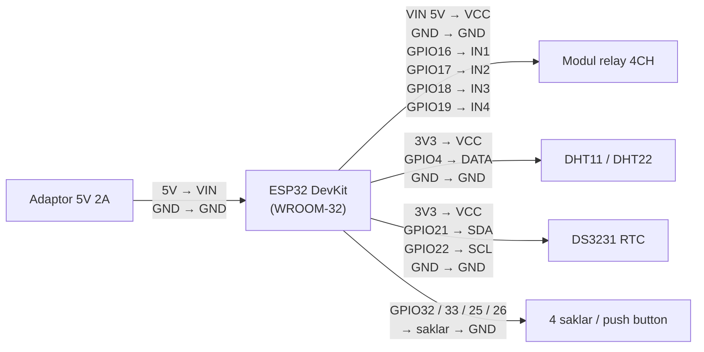

<div align="center">

# 💡 Luminous — ESP32 Smart Relay

**Kendalikan 4 perangkat listrik dari HP, jadwal otomatis, sensor suhu & kelembaban, dan saklar fisik — semua lewat MQTT.**




*Kiri ke kanan: tab Kontrol (terang & gelap), tab Otomasi (terang & gelap)*

</div>

---

## Daftar Isi

1. [Apa itu Luminous?](#1-apa-itu-luminous)
2. [Fitur](#2-fitur)
3. [Cara kerja sistem](#3-cara-kerja-sistem)
4. [Struktur repository](#4-struktur-repository)
5. [Daftar komponen (BOM)](#5-daftar-komponen-bom)
6. [Tutorial pemula: dari nol sampai jalan](#6-tutorial-pemula-dari-nol-sampai-jalan)
   - [Langkah 1 — Instal Arduino IDE](#langkah-1--instal-arduino-ide)
   - [Langkah 2 — Tambahkan board ESP32](#langkah-2--tambahkan-board-esp32)
   - [Langkah 3 — Instal library](#langkah-3--instal-library)
   - [Langkah 4 — Rangkai hardware](#langkah-4--rangkai-hardware)
   - [Langkah 5 — Atur firmware](#langkah-5--atur-firmware)
   - [Langkah 6 — Upload ke ESP32](#langkah-6--upload-ke-esp32)
   - [Langkah 7 — Cek lewat Serial Monitor](#langkah-7--cek-lewat-serial-monitor)
   - [Langkah 8 — Buka dashboard](#langkah-8--buka-dashboard)
   - [Langkah 9 — Pengaturan pertama kali](#langkah-9--pengaturan-pertama-kali)
7. [Panduan memakai dashboard](#7-panduan-memakai-dashboard)
8. [Online-kan dashboard (GitHub Pages / Netlify / Vercel)](#8-online-kan-dashboard-github-pages--netlify--vercel)
9. [Update firmware lewat WiFi (OTA)](#9-update-firmware-lewat-wifi-ota)
10. [Referensi konfigurasi firmware](#10-referensi-konfigurasi-firmware)
11. [Referensi MQTT: topik & perintah](#11-referensi-mqtt-topik--perintah)
12. [Keamanan & keselamatan listrik](#12-keamanan--keselamatan-listrik)
13. [Troubleshooting](#13-troubleshooting)
14. [FAQ](#14-faq)
15. [Riwayat versi](#15-riwayat-versi)
16. [Kontribusi & lisensi](#16-kontribusi--lisensi)

---

## 1. Apa itu Luminous?

Luminous adalah sistem **smart relay 4 channel** berbasis ESP32. ESP32 menyalakan/mematikan 4 relay (lampu, kipas, pompa, stop kontak, dll.), membaca sensor suhu–kelembaban DHT, menyimpan jam di modul RTC DS3231, dan terhubung ke internet lewat **MQTT broker publik EMQX**.

Anda mengendalikannya dari **dashboard web** (bisa dibuka di HP maupun laptop) atau langsung dari **saklar fisik** di dinding. Jadwal, aturan otomatis, dan kunci saklar disimpan di memori ESP32 (NVS), jadi **tetap berjalan walau dashboard ditutup atau listrik sempat padam**.

> **Untuk siapa?** Pemula yang baru mengenal ESP32 bisa mengikuti [Tutorial pemula](#6-tutorial-pemula-dari-nol-sampai-jalan) langkah demi langkah. Yang sudah berpengalaman bisa langsung ke [Referensi MQTT](#11-referensi-mqtt-topik--perintah).

---

## 2. Fitur

### Firmware ESP32 (`firmware/main/main.ino`)

| Kategori | Fitur |
|---|---|
| **Kontrol relay** | 4 relay, kontrol dari dashboard, Serial Monitor, WebSocket lokal, atau saklar fisik |
| **Saklar manual** | 1 saklar per relay (saklar dinding *atau* push button), debounce, tahan 3 detik = semua OFF, kunci saklar dari dashboard |
| **Timer** | Hitung mundur per relay (maks 4 timer aktif, maks 24 jam) — "nyalakan/matikan setelah X menit" |
| **Jadwal (NVS)** | 4 slot: jam tetap **atau** relatif matahari terbit/terbenam (± menit), setiap hari / hari tertentu / sekali |
| **Automation rules** | 4 aturan berbasis sensor, mendukung 2 kondisi (DAN). Contoh: *suhu > 30 °C dan kelembaban > 70 % → Kipas ON* |
| **Sensor** | DHT11/DHT22 tiap 5 detik, alert ambang batas, statistik min/rata-rata/maks |
| **Riwayat** | 288 titik (1 titik / 5 menit = 24 jam) tersimpan di NVS |
| **Jam** | RTC DS3231, waktu WIB, jam terbit/terbenam dihitung offline di ESP32 |
| **Kesehatan** | Uptime, RSSI WiFi, free heap, jumlah timer & rule, ping |
| **OTA** | Update firmware lewat WiFi (Arduino IDE port jaringan, atau upload `.bin` dari dashboard) |
| **Keandalan** | FreeRTOS multi-task (Core 0 jaringan, Core 1 logika), mutex, watchdog, auto-reconnect WiFi & MQTT |

### Dashboard web (`dashboard/`)

- Desain **neumorphism** lembut, tema **terang & gelap** (otomatis mengikuti pengaturan perangkat), tanpa efek glow.
- Tab **Kontrol** — 4 kartu relay, timer, tombol *Semua OFF*, grafik suhu & kelembaban (live atau riwayat 24 jam).
- Tab **Otomasi** — kelola jadwal & automation rules.
- Tab **Analitik** — statistik sensor, estimasi pemakaian listrik (kWh) per relay, kesehatan perangkat.
- Tab **Setting** — broker MQTT, jam RTC, lokasi, ambang alert, notifikasi, nama/ikon/daya relay, saklar manual, latar belakang, OTA.
- Semua icon berupa file SVG lokal dengan varian **light & dark**.
- **Mode demo** (`preview.html` atau `index.html?demo`) — coba semua fitur tanpa ESP32.
- Tidak perlu server/backend: cukup file HTML + CSS + JS statis.

---

## 3. Cara kerja sistem



1. ESP32 terhubung ke WiFi lalu ke broker MQTT `broker.emqx.io` (port 1883).
2. Dashboard di browser terhubung ke broker yang sama lewat **WebSocket** (port 8083 untuk `ws://`, 8084 untuk `wss://`).
3. Dashboard **mengirim perintah teks** ke topik `esp32/command`, misalnya `relay1 true`.
4. ESP32 menjalankan perintah lalu **mengirim status** ke topik lain (`esp32/relayStatus`, `esp32/health`, dst.). Dashboard menampilkan status itu.

> Broker hanya "kantor pos": menerima dan meneruskan pesan. Dashboard dan ESP32 tidak perlu berada di jaringan yang sama — kecuali untuk fitur OTA.

---

## 4. Struktur repository

```
luminous/
├── README.md                 ← dokumen ini
├── LICENSE                   ← lisensi MIT
├── .gitignore
├── docs/
│   └── images/preview.png    ← gambar preview
├── firmware/
│   └── main/
│       └── main.ino          ← firmware ESP32 (buka file ini di Arduino IDE)
└── dashboard/
    ├── index.html            ← dashboard utama
    ├── preview.html          ← mode demo (ESP32 simulasi)
    ├── css/style.css
    ├── js/app.js             ← logika dashboard + MQTT
    ├── js/demo.js            ← simulasi ESP32 untuk mode demo
    ├── icons/ui/             ← icon UI   (nama-light.svg / nama-dark.svg)
    ├── icons/relay/          ← icon relay (preset-on|off-light|dark.svg)
    ├── netlify.toml          ← konfigurasi deploy Netlify
    └── vercel.json           ← konfigurasi deploy Vercel
```

> **Penting:** Arduino IDE mewajibkan nama folder sama dengan nama file `.ino`. Karena itu firmware ada di `firmware/main/main.ino`. Jangan ganti nama salah satunya saja.

---

## 5. Daftar komponen (BOM)

| No | Komponen | Jumlah | Keterangan |
|---|---|---|---|
| 1 | **ESP32 DevKit V1** (modul ESP32-WROOM-32, 30/38 pin) | 1 | Hindari varian **WROVER**: GPIO16/17 dipakai PSRAM |
| 2 | **Modul relay 4 channel 5V** dengan optocoupler | 1 | Tipe *active-LOW* (umum di pasaran) |
| 3 | **Sensor DHT11** (atau DHT22 untuk akurasi lebih baik) | 1 | Versi modul 3 pin sudah ada resistor pull-up |
| 4 | **Modul RTC DS3231** + baterai CR2032 | 1 | Jam tetap jalan saat listrik padam |
| 5 | **Saklar dinding** atau **push button** | 4 | Opsional — untuk kontrol manual |
| 6 | Power supply **5V minimal 2A** (adaptor/HLK-PM01) | 1 | Relay butuh arus cukup besar |
| 7 | Kabel jumper (female–female / male–female) | ± 20 | |
| 8 | Kabel data **USB** (bukan kabel charge saja) | 1 | Untuk upload firmware |
| 9 | Box/enclosure, terminal, sekring/MCB | – | Wajib jika relay menyambung listrik 220V |

---

## 6. Tutorial pemula: dari nol sampai jalan

Estimasi waktu: **1–2 jam** untuk pertama kali.

### Langkah 1 — Instal Arduino IDE

1. Unduh **Arduino IDE 2.x** dari <https://www.arduino.cc/en/software>.
2. Instal seperti aplikasi biasa, lalu buka.
3. **Windows:** jika nanti port ESP32 tidak muncul, instal driver USB sesuai chip di board Anda:
   - Chip **CP2102** → driver *CP210x* dari Silicon Labs.
   - Chip **CH340/CH341** → driver *CH340* dari WCH.

   (Lihat tulisan di chip kecil dekat port USB board ESP32.)

### Langkah 2 — Tambahkan board ESP32

1. Buka **File → Preferences** (macOS: **Arduino IDE → Settings**).
2. Di kolom **Additional boards manager URLs**, tempel:
   ```
   https://espressif.github.io/arduino-esp32/package_esp32_index.json
   ```
3. Klik **OK**.
4. Buka **Tools → Board → Boards Manager**, cari **`esp32`**, pilih **esp32 by Espressif Systems**, klik **Install** (versi 3.x disarankan; 2.x juga didukung).
5. Tunggu sampai selesai (unduhan cukup besar, ± 300 MB).

### Langkah 3 — Instal library

Buka **Tools → Manage Libraries** (atau ikon buku di sisi kiri), lalu cari dan instal:

| Cari dengan kata kunci | Pilih library | Dipakai untuk |
|---|---|---|
| `MQTT` | **MQTT** by *Joel Gaehwiler* | Koneksi ke broker (`MQTT.h`) |
| `DHT sensor library` | **DHT sensor library** by *Adafruit* | Sensor DHT (`DHT.h`) |
| `Adafruit Unified Sensor` | **Adafruit Unified Sensor** by *Adafruit* | Dependensi DHT |
| `WebSockets` | **WebSockets** by *Markus Sattler* | WebSocket lokal (`WebSocketsServer.h`) |
| `RTClib` | **RTClib** by *Adafruit* | Modul DS3231 (`RTClib.h`) |

> Jika muncul pertanyaan *"Install all dependencies?"*, pilih **Install All** (misalnya Adafruit BusIO untuk RTClib).
>
> `WiFi`, `Wire`, `Preferences`, `WebServer`, `Update`, `ArduinoOTA` sudah termasuk dalam paket board ESP32 — **tidak perlu** diinstal.
>
> Hati-hati: ada beberapa library bernama mirip "MQTT". Pilih yang pembuatnya **Joel Gaehwiler** (256dpi), bukan PubSubClient.

### Langkah 4 — Rangkai hardware

> ⚠️ **Lakukan semua perakitan dalam keadaan ESP32 TIDAK terhubung ke USB/listrik.** Uji dulu tanpa beban 220V (lampu relay di modul sudah cukup sebagai tanda).

#### Tabel koneksi

| Komponen | Pin komponen | Ke ESP32 |
|---|---|---|
| **Modul relay** | VCC | **VIN / 5V** |
| | GND | GND |
| | IN1 | **GPIO16** |
| | IN2 | **GPIO17** |
| | IN3 | **GPIO18** |
| | IN4 | **GPIO19** |
| **DHT11 / DHT22** | VCC (+) | **3V3** |
| | DATA (OUT) | **GPIO4** |
| | GND (−) | GND |
| **DS3231** | VCC | **3V3** |
| | GND | GND |
| | SDA | **GPIO21** |
| | SCL | **GPIO22** |
| **Saklar 1–4** *(opsional)* | kaki 1 | **GPIO32 / 33 / 25 / 26** |
| | kaki 2 | GND |

#### Diagram




#### Catatan wiring

- **Semua GND harus tersambung** (ESP32, relay, DHT, RTC, power supply).
- **Saklar tidak butuh resistor** — firmware memakai pull-up internal ESP32. Saklar hanya mengalirkan sinyal ke GPIO, **jangan** dialiri listrik 220V (lihat [Keselamatan](#12-keamanan--keselamatan-listrik)).
- **Sisi beban relay (220V):** sambungkan kabel fasa (L) ke **COM**, lalu dari **NO** (*Normally Open*) ke perangkat. Netral langsung ke perangkat. Dengan NO, perangkat mati saat ESP32 mati.
- Jika modul relay punya jumper **JD-VCC**, biarkan terpasang untuk pemakaian standar.
- Modul relay yang **active-HIGH** (jarang)? Ubah `RELAY_ON`/`RELAY_OFF` di firmware (lihat [Langkah 5](#langkah-5--atur-firmware)).

### Langkah 5 — Atur firmware

1. Unduh repository ini: tombol hijau **Code → Download ZIP**, lalu ekstrak. (Atau `git clone` jika sudah terbiasa.)
2. Di Arduino IDE: **File → Open** → pilih `firmware/main/main.ino`.
3. Ubah bagian konfigurasi di bagian atas file:

```cpp
const char* WIFI_SSID   = "NAMA_WIFI_ANDA";      // nama WiFi (harus 2.4 GHz)
const char* WIFI_PASS   = "PASSWORD_WIFI_ANDA";  // password WiFi
const char* MQTT_SERVER = "broker.emqx.io";      // biarkan jika memakai EMQX publik
const int   MQTT_PORT   = 1883;
const int   GMT_OFFSET_HOURS = 7;                // WIB=7, WITA=8, WIT=9

#define TOPIC_PREFIX "esp32"                     // ← SANGAT disarankan diganti (lihat bawah)
```

4. **Ganti `TOPIC_PREFIX` dengan nama unik**, misalnya `"luminous-budi-7f3a"`. Broker EMQX bersifat publik: siapa pun yang tahu nama topik Anda bisa mengirim perintah ke relay. Nama unik membuat topik Anda sulit ditebak. Catat nama ini — nanti diisi juga di dashboard.
5. Jika memakai **DHT22**, ubah:
   ```cpp
   #define DHTTYPE  DHT22
   ```
6. (Opsional) Ubah pin atau tipe saklar:
   ```cpp
   const uint8_t SWITCH_PINS[4] = {32, 33, 25, 26};
   const SwitchType SWITCH_TYPE[4] = {SW_TOGGLE, SW_TOGGLE, SW_TOGGLE, SW_TOGGLE};
   // SW_TOGGLE = saklar dinding biasa, SW_PUSH = push button
   ```

> 🔒 **Jangan pernah commit password WiFi asli ke GitHub.** Jika repo Anda publik, kembalikan `WIFI_SSID`/`WIFI_PASS` ke placeholder sebelum `git push`.

### Langkah 6 — Upload ke ESP32

1. Sambungkan ESP32 ke laptop dengan kabel USB data.
2. **Tools → Board → esp32 → ESP32 Dev Module**.
3. **Tools → Port** → pilih port yang muncul (Windows: `COM3`, `COM4`, …; macOS: `/dev/cu.usbserial-…`; Linux: `/dev/ttyUSB0`).
4. **Tools → Partition Scheme** → biarkan **Default 4MB with spiffs**. Jika saat compile muncul *"Sketch too big"*, pilih **Minimal SPIFFS (1.9MB APP with OTA)**.
5. Klik tombol **Upload** (ikon panah →).
6. Saat muncul tulisan `Connecting........`, jika macet: **tekan dan tahan tombol BOOT** di board sampai persentase upload mulai berjalan, lalu lepas.
7. Tunggu sampai muncul **"Done uploading"** / **"Hard resetting via RTS pin"**.

### Langkah 7 — Cek lewat Serial Monitor

1. **Tools → Serial Monitor**, set baud rate **115200** di pojok kanan bawah.
2. Tekan tombol **EN/RST** di board. Anda akan melihat log seperti:
   ```
   [WiFi] IP: 192.168.1.77
   === Luminous v4.2 Siap ===
   Topik MQTT: esp32/...
   [MQTT] Connect (luminous_A1B2C3)... OK
   [MQTT] All relay states published
   [Sun] 2026-11-12 lat=-6.2088 lon=106.8456 terbit 05:26 terbenam 17:47
   ```
   Urutan baris bisa sedikit berbeda karena tiap bagian berjalan di task terpisah.
3. **Coba perintah** langsung dari Serial Monitor (ketik di kolom input, tekan Enter):
   ```
   relay1 true
   relay1 false
   status
   ```
   Relay 1 harus berbunyi "klik" dan lampu indikatornya menyala/mati. Perintah `status` menampilkan ringkasan kondisi ESP32.

> Jika `[RTC] DS3231 tidak ditemukan!` → cek kabel SDA/SCL. Jika WiFi tidak tersambung → pastikan WiFi 2.4 GHz dan password benar. Lihat [Troubleshooting](#13-troubleshooting).

### Langkah 8 — Buka dashboard

**Cara tercepat (tanpa hosting):**

1. Buka folder `dashboard/`, klik dua kali **`index.html`** — dashboard terbuka di browser.
2. Masuk ke tab **Setting → Koneksi MQTT Broker**, isi:

   | Kolom | Isi |
   |---|---|
   | Host Broker | `broker.emqx.io` |
   | Port (WebSocket) | `8083` |
   | Protokol | `ws://` |
   | Path WebSocket | `/mqtt` |
   | Prefix Topic | **sama persis** dengan `TOPIC_PREFIX` di firmware |

3. Klik **Simpan & Sambungkan**. Status di pojok kanan atas berubah menjadi 🟢 **ESP32 online** dalam beberapa detik.

**Ingin mencoba dulu tanpa ESP32?** Buka `dashboard/preview.html` — semua data disimulasikan.

> Ingin dashboard bisa dibuka dari mana saja lewat link? Lihat [bagian 8](#8-online-kan-dashboard-github-pages--netlify--vercel).

### Langkah 9 — Pengaturan pertama kali

Lakukan sekali setelah ESP32 online (semua di tab **Setting**):

1. **Waktu Perangkat (RTC)** → klik **Set RTC dari Browser**. Jam ESP32 akan sama dengan jam HP/laptop Anda (WIB).
2. **Lokasi** → klik **Pakai Lokasi Saya** (atau isi latitude/longitude manual) → **Simpan Lokasi**. Ini dipakai untuk jadwal matahari terbit/terbenam.
3. **Ambang & Notifikasi** → atur batas suhu/kelembaban → **Kirim Ambang ke ESP32**.
4. **Nama, Ikon & Daya Relay** → beri nama (mis. *Lampu Teras*), pilih ikon, isi daya dalam watt → **Simpan**.

Selesai 🎉 — sistem siap dipakai.

---

## 7. Panduan memakai dashboard

### Bagian atas (selalu terlihat)

| Elemen | Fungsi |
|---|---|
| Status 🟢🟠🔴 | 🟢 ESP32 online · 🟠 broker tersambung tapi ESP32 belum menjawab · 🔴 broker terputus |
| Kartu Suhu & Kelembaban | Nilai terkini + status *Normal / Mendekati ambang / Di atas ambang* |
| Jam | Jam DS3231 di ESP32 + umur data sensor |
| Terbit / Terbenam | Dihitung oleh ESP32 dari lokasi yang Anda simpan |

### Tab Kontrol

- **Saklar di kartu relay** — tap untuk ON/OFF. Teks kecil di bawah nama menunjukkan **siapa yang terakhir mengubah**: *saklar*, *dashboard*, *jadwal*, *timer*, atau *rule*. Ikon 🔒 = saklar fisik relay itu sedang dikunci.
- **Ikon stopwatch** — buka timer:
  - *Nyalakan sekarang, matikan setelah durasi* — cocok untuk pompa air.
  - *Matikan setelah durasi* / *Nyalakan setelah durasi*.
- **Semua OFF** — mematikan semua relay yang menyala.
- **Statistik Sensor** — grafik suhu & kelembaban. `30 / 60 / 120` = jumlah sampel live terakhir, `24 jam` = riwayat yang tersimpan di ESP32.

### Tab Otomasi

**Jadwal (4 slot)** — klik **Tambah Jadwal**:

1. Pilih relay dan aksi (ON/OFF).
2. Pilih mode: **Jam tetap**, **Terbit**, atau **Terbenam**. Untuk mode matahari, isi selisih menit (contoh `-15` = 15 menit sebelum terbenam). Jam otomatis bergeser mengikuti musim.
3. Pilih pengulangan: **Setiap hari**, **Hari tertentu** (pilih harinya), atau **Sekali saja**.
4. Klik **Simpan ke ESP32**.

**Automation Rules (4 slot)** — klik **Tambah Rule**, contoh:

> Jika **Suhu > 30 °C** *dan* **Kelembaban > 70 %** → **Kipas Angin ON**

Aktifkan *Tambah kondisi kedua (DAN)* untuk memakai dua kondisi.

### Tab Analitik

- **Statistik Sensor** — min / rata-rata / maks sejak ESP32 menyala.
- **Pemakaian Relay** — total waktu ON, jumlah siklus, dan **estimasi kWh** (= waktu ON × daya yang Anda isi di Setting).
- **Kesehatan Perangkat** — uptime, kekuatan sinyal WiFi, free heap, latensi (tombol **Ping**), timer aktif, jumlah riwayat.

### Tab Setting

| Bagian | Isi |
|---|---|
| Koneksi MQTT Broker | Host, port, protokol, path, user/password (opsional), prefix topik |
| Waktu Perangkat (RTC) | Sinkronkan jam ESP32 dengan browser, atau atur manual |
| Lokasi | Untuk jam terbit/terbenam & jadwal matahari |
| Ambang & Notifikasi | Batas alert suhu/kelembaban, notifikasi browser |
| Riwayat Alert | 30 alert terakhir |
| Nama, Ikon & Daya Relay | Tampilan & perhitungan kWh |
| Saklar Manual | Pin, tipe, posisi saklar saat ini, **kunci per relay** atau semua |
| Latar Belakang | Gambar dari URL / upload, opacity overlay, blur |
| Tampilan | Tema terang / gelap |
| OTA Firmware | Update firmware dari dashboard (lihat [bagian 9](#9-update-firmware-lewat-wifi-ota)) |

### Memakai saklar fisik

- **Saklar dinding (`SW_TOGGLE`)** — setiap kali posisinya **dibalik**, relay ikut berbalik. Jadi saklar dan dashboard bisa dipakai bergantian: relay dinyalakan dari dashboard → balik saklar → relay mati.
- **Push button (`SW_PUSH`)** — tekan = balik relay, **tahan 3 detik = matikan semua relay**.
- Saat ESP32 menyala, posisi saklar hanya dicatat — relay **tidak** tiba-tiba menyala setelah listrik padam.
- Saklar yang **dikunci** dari dashboard diabaikan ESP32 (cocok sebagai kunci anak).

---

## 8. Online-kan dashboard (GitHub Pages / Netlify / Vercel)

Dashboard hanya file statis, jadi bisa di-hosting gratis. Setelah online, link-nya bisa dibuka dari HP di mana pun.

### Opsi A — GitHub Pages

1. Upload repository ini ke GitHub (lihat langkah singkat di bawah).
2. Di repo: **Settings → Pages → Build and deployment**.
3. **Source:** *Deploy from a branch* → **Branch:** `main`, folder **`/ (root)`** → **Save**.
4. Tunggu 1–2 menit. Dashboard tersedia di:
   ```
   https://USERNAME.github.io/NAMA-REPO/dashboard/
   ```

### Opsi B — Netlify (drag & drop)

1. Buka <https://app.netlify.com/drop>.
2. Seret **folder `dashboard/`** ke halaman itu. Selesai — Netlify memberi link `https://…netlify.app`.

### Opsi C — Vercel

1. Impor repo di <https://vercel.com/new>.
2. Set **Root Directory** = `dashboard`, framework **Other**, lalu **Deploy**.

> Situs hosting memakai **HTTPS**, sehingga dashboard otomatis tersambung lewat **`wss://` port 8084**. Ini normal. Satu-satunya fitur yang tidak berjalan dari HTTPS adalah **upload OTA dari dashboard** (lihat bagian berikut).

### Upload repo ke GitHub (untuk pemula)

**Lewat website (tanpa perintah):** buat repo baru di <https://github.com/new> → **uploading an existing file** → seret seluruh isi folder project → **Commit changes**.

**Lewat Git:**

```bash
cd luminous
git init
git add .
git commit -m "Luminous v4.2"
git branch -M main
git remote add origin https://github.com/USERNAME/luminous.git
git push -u origin main
```

> Sebelum push, pastikan `WIFI_SSID` dan `WIFI_PASS` di `main.ino` masih **placeholder**.

---

## 9. Update firmware lewat WiFi (OTA)

Setelah upload pertama via USB, update berikutnya bisa tanpa kabel.

### Cara 1 — Dari Arduino IDE (paling mudah)

1. Pastikan laptop dan ESP32 di **jaringan WiFi yang sama**.
2. **Tools → Port** → di bagian *Network ports* pilih **`luminous-esp32`**.
3. Klik **Upload**.

### Cara 2 — Dari dashboard

1. Di Arduino IDE: **Sketch → Export Compiled Binary**. File `.bin` muncul di folder `build/` di dalam folder sketch.
2. Buka dashboard dari **file lokal** (`index.html`) atau `http://` — **bukan** link HTTPS.
3. **Setting → OTA Firmware → Cek** (untuk mengambil IP ESP32) → **Pilih file .bin** → **Flash Firmware**.
4. ESP32 akan restart otomatis setelah selesai.

> Jangan cabut listrik ESP32 saat proses OTA berjalan.

---

## 10. Referensi konfigurasi firmware

Semua ada di bagian atas `firmware/main/main.ino`.

| Konstanta | Default | Keterangan |
|---|---|---|
| `WIFI_SSID`, `WIFI_PASS` | placeholder | WiFi 2.4 GHz |
| `MQTT_SERVER`, `MQTT_PORT` | `broker.emqx.io`, `1883` | Broker MQTT (TCP) |
| `TOPIC_PREFIX` | `"esp32"` | Awalan semua topik — samakan dengan dashboard |
| `GMT_OFFSET_HOURS` | `7` | Zona waktu (WIB) |
| `DEFAULT_LAT`, `DEFAULT_LON` | Jakarta | Lokasi awal (bisa diubah dari dashboard) |
| `DHTPIN`, `DHTTYPE` | `4`, `DHT11` | Pin & tipe sensor |
| `RELAY_PINS[4]` | `16, 17, 18, 19` | Pin relay |
| `RELAY_ON`, `RELAY_OFF` | `LOW`, `HIGH` | Untuk relay active-LOW; tukar jika active-HIGH |
| `SWITCH_PINS[4]` | `32, 33, 25, 26` | Pin saklar (pakai pin yang punya pull-up: 13, 14, 25, 26, 27, 32, 33) |
| `SWITCH_TYPE[4]` | `SW_TOGGLE` ×4 | `SW_TOGGLE` saklar dinding / `SW_PUSH` push button |
| `SWITCH_DEBOUNCE_MS` | `50` | Anti-getar kontak saklar |
| `SWITCH_LONGPRESS_MS` | `3000` | Tahan push button = semua relay OFF |
| `SENSOR_INTERVAL` | `5000` ms | Interval baca & kirim sensor |
| `HISTORY_INTERVAL` | `300000` ms | Interval simpan riwayat (5 menit) |

**Port yang dibuka ESP32 di jaringan lokal:** 80 (HTTP OTA), 81 (WebSocket), 3232 (ArduinoOTA).

---

## 11. Referensi MQTT: topik & perintah

Semua topik diawali `TOPIC_PREFIX` (default `esp32`). Contoh: `esp32/command`.

### Mencoba tanpa dashboard (MQTTX)

1. Instal **MQTTX** (<https://mqttx.app>) atau pakai web client <https://mqttx.app/web-client>.
2. Buat koneksi: host `broker.emqx.io`, port `1883` (aplikasi desktop) atau `8084` + `wss` (web client).
3. Subscribe ke `esp32/#`.
4. Publish ke `esp32/command` dengan payload `relay1 true` → relay 1 menyala dan Anda melihat balasan di `esp32/relayStatus`.

### Perintah (publish teks ke `<prefix>/command`)

Perintah yang sama juga bisa diketik di **Serial Monitor** (115200 baud).

| Perintah | Contoh | Fungsi |
|---|---|---|
| `relay<N> <true\|false>` | `relay2 true` | Nyalakan/matikan relay N (1–4) |
| `timer_on relay<N> <detik>` | `timer_on relay3 600` | Nyalakan relay setelah X detik |
| `timer_off relay<N> <detik>` | `timer_off relay1 300` | Matikan relay setelah X detik |
| `save_schedule:<slot>:<relay>:<on\|off>:<HH>:<MM>:<repeat>[:<days>:<mode>:<offset>]` | `save_schedule:1:1:on:00:00:daily:127:sunset:-15` | Simpan jadwal (lihat penjelasan di bawah) |
| `del_schedule:<slot>` | `del_schedule:2` | Hapus jadwal slot 1–4 |
| `get_schedules` | | Kirim daftar jadwal |
| `set_rule:<id>:<sensor>:<cond>:<nilai>:<relay>:<on\|off>[:<sensor2>:<cond2>:<nilai2>]` | `set_rule:1:temp:above:30:2:on:hum:above:70` | Simpan automation rule |
| `del_rule:<id>` | `del_rule:1` | Hapus rule |
| `rules` | | Kirim daftar rule |
| `set_threshold:<key>:<nilai>` | `set_threshold:temp_hi:35` | Ambang alert: `temp_hi`, `temp_lo`, `hum_hi`, `hum_lo` |
| `set_time:<YYYY>:<MM>:<DD>:<hh>:<mm>:<ss>` | `set_time:2026:11:12:20:30:00` | Atur jam RTC (WIB) |
| `get_time` | | Kirim jam RTC |
| `set_location:<lat>:<lon>` | `set_location:-7.2575:112.7521` | Simpan lokasi untuk jadwal matahari |
| `get_sun` | | Kirim jam terbit/terbenam |
| `switch_lock:<1-4\|all>:<on\|off>` | `switch_lock:all:on` | Kunci/buka saklar fisik |
| `get_switches` | | Kirim status saklar |
| `get_history:<n>` | `get_history:288` | Kirim riwayat sensor (bertahap, 24 titik per pesan) |
| `clear_history` | | Hapus riwayat & statistik |
| `sync` | | Kirim **semua** status (relay, health, rules, jadwal, jam, matahari, saklar) |
| `stats` | | Kirim statistik pemakaian tiap relay |
| `health` | | Kirim laporan kesehatan |
| `ping` | | Dibalas di topik `pong` |
| `ota_info` | | Kirim IP & versi untuk OTA |
| `status` | | Cetak ringkasan di Serial Monitor |
| `reboot` | | Restart ESP32 |

**Detail `save_schedule`:**

| Bagian | Nilai |
|---|---|
| `slot` | 1–4 |
| `relay` | 1–4 |
| `repeat` | `daily` (setiap hari), `weekly` (hari tertentu), `none` (sekali) |
| `days` | Bitmask hari: Minggu=1, Senin=2, Selasa=4, Rabu=8, Kamis=16, Jumat=32, Sabtu=64. Contoh Senin–Jumat = 2+4+8+16+32 = **62**, setiap hari = **127** |
| `mode` | `fixed` (pakai HH:MM), `sunrise`, `sunset` |
| `offset` | Selisih menit untuk mode matahari, −720 s/d 720 |

Format lama tanpa `days/mode/offset` tetap diterima (dianggap jam tetap, setiap hari).

**Detail `set_rule`:** `sensor` = `temp`/`hum`, `cond` = `above`/`below`.

### Topik yang dikirim ESP32

| Topik | Contoh payload | Kapan |
|---|---|---|
| `temperature679` | `28.6` | Tiap 5 detik |
| `humidity679` | `66.4` | Tiap 5 detik |
| `relayStatus` | `relay1 true` | Setiap relay berubah / `sync` |
| `relay_event` | `{"relay":1,"state":true,"src":"switch"}` | Setiap relay diubah; `src` = `switch`, `switch_all`, `remote`, `schedule`, `timer`, `rule` |
| `health` | `{"uptime":5230,"heap":181000,"rssi":-61,...}` | Tiap 10 detik |
| `relay_stats` | `{"relay":1,"on_ms":3600000,"cycles":4,"is_on":true}` | Perintah `stats` |
| `timer_status` | `{"relay":3,"action":"off","remaining":120,"total":300,"active":true}` | Selama timer berjalan |
| `schedules` | `{"n":4,"slots":[{"id":1,"mode":"sunset","offset":-15,...}]}` | Jadwal berubah / `get_schedules` |
| `rules` | `[{"id":1,"active":true,"sensor":"temp",...}]` | Rule berubah / `rules` |
| `history` | `{"n":24,"total":288,"offset":0,"data":[...]}` | Perintah `get_history` |
| `time` | `{"time":"20:30:05","date":"12/11/2026","epoch":...,"valid":true}` | Tiap 30 detik |
| `sun` | `{"sunrise":"05:26","sunset":"17:47","lat":-6.2088,"lon":106.8456}` | Ganti hari / lokasi |
| `switches` | `{"pins":[32,33,25,26],"type":[...],"locked":[...],"pos":[...]}` | Saklar berubah / dikunci |
| `alert` | `{"type":"temp_hi","val":38.2}` | Lewat ambang, sensor gagal, rule jalan, saklar terkunci ditekan |
| `config_ack` | `{"type":"schedule_set","slot":1}` | Konfirmasi perintah simpan |
| `pong` | `{...}` | Balasan `ping` |
| `status` | `online` | Saat tersambung |
| `sync_ack` | `{"type":"sync_ok","ts":...}` | Selesai `sync` |
| `ota_status`, `ota_progress` | `{"ip":"192.168.1.77","version":"4.2",...}` | Info & progres OTA |

---

## 12. Keamanan & keselamatan listrik

### ⚡ Keselamatan listrik 220V

- **Listrik 220V bisa berakibat fatal.** Jika belum pernah, minta bantuan orang yang paham instalasi listrik.
- Selalu **matikan MCB** sebelum menyambung kabel ke relay.
- Gunakan **box tertutup**, terminal yang kencang, dan kabel sesuai beban.
- Perhatikan batas modul relay (umumnya **10A 250VAC**); jangan dipakai untuk beban motor/pemanas besar tanpa kontaktor.
- **Saklar manual hanya untuk sinyal ke GPIO.** Jangan sambungkan saklar yang sedang dialiri 220V ke ESP32. Untuk memakai saklar dinding yang sudah ada di jalur listrik, perlu modul pendeteksi 220V terisolasi (optocoupler).

### 🔒 Keamanan MQTT

- `broker.emqx.io` adalah **broker publik tanpa password** — semua orang bisa subscribe/publish ke topik apa pun.
- **Ganti `TOPIC_PREFIX`** ke nama unik (lihat [Langkah 5](#langkah-5--atur-firmware)).
- Untuk keamanan lebih baik, gunakan broker pribadi (mis. EMQX Cloud Serverless gratis, HiveMQ Cloud, atau Mosquitto di rumah) dengan username & password. Firmware saat ini tersambung ke broker tanpa autentikasi; menambahkan login perlu sedikit modifikasi di `reconnectMQTT()`.
- **Jangan commit** password WiFi ke GitHub.

---

## 13. Troubleshooting

| Masalah | Penyebab umum | Solusi |
|---|---|---|
| Port ESP32 tidak muncul di Arduino IDE | Driver belum terpasang / kabel hanya untuk charge | Instal driver CP210x atau CH340; ganti kabel USB data |
| Upload macet di `Connecting.....` | ESP32 tidak masuk mode bootloader | Tahan tombol **BOOT** saat upload dimulai |
| `fatal error: MQTT.h: No such file` | Library belum terpasang | Instal **MQTT by Joel Gaehwiler** ([Langkah 3](#langkah-3--instal-library)) |
| `Sketch too big` | Partisi terlalu kecil | **Tools → Partition Scheme → Minimal SPIFFS (1.9MB APP with OTA)** |
| Error terkait `esp_task_wdt` | Versi paket board lama | Update **esp32 by Espressif** ke versi 3.x |
| WiFi tidak tersambung | WiFi 5 GHz / password salah | Pakai WiFi **2.4 GHz**, cek SSID & password (huruf besar/kecil berpengaruh) |
| Dashboard 🔴 *Terputus* | Port/protokol salah | `ws` + port `8083` (file lokal/http) atau `wss` + `8084` (https), path `/mqtt` |
| Dashboard 🟠 *Menunggu ESP32* | Prefix topik beda / ESP32 offline | Samakan **Prefix Topic** dengan `TOPIC_PREFIX`; cek Serial Monitor |
| Relay menyala saat seharusnya mati (terbalik) | Modul relay active-HIGH | Tukar nilai `RELAY_ON` dan `RELAY_OFF` |
| Relay "klik" tapi beban tidak menyala | Salah terminal | Pakai **COM** dan **NO**, cek kabel fasa |
| Suhu `--` / alert *Sensor DHT gagal* | Kabel DATA / tipe DHT salah | Cek GPIO4, VCC 3V3, dan `DHTTYPE` |
| `[RTC] DS3231 tidak ditemukan!` | SDA/SCL tertukar atau lepas | SDA → GPIO21, SCL → GPIO22 |
| Jam ESP32 salah / "RTC belum diset" | RTC baru / baterai habis | **Setting → Set RTC dari Browser**; ganti baterai CR2032 |
| Jadwal matahari jamnya aneh | Lokasi belum diset | **Setting → Lokasi → Simpan Lokasi** |
| Saklar tidak bereaksi | Saklar dikunci / pin salah | Buka kunci di **Setting → Saklar Manual**; cek `SWITCH_PINS` |
| Relay berganti sendiri saat saklar disentuh | Kabel saklar panjang menangkap noise | Pakai kabel twisted/pendek; naikkan `SWITCH_DEBOUNCE_MS` (mis. 80) |
| OTA dari dashboard gagal | Dashboard dibuka via HTTPS / beda jaringan | Buka `index.html` lokal, satu WiFi dengan ESP32; atau OTA lewat Arduino IDE |
| ESP32 sering restart | Daya kurang saat relay aktif | Pakai adaptor 5V **2A**, kabel USB pendek/berkualitas |

**Tips debug:** buka Serial Monitor (115200) — hampir semua kejadian dicatat di sana (`[WiFi]`, `[MQTT]`, `[Switch]`, `[Sched]`, `[Rule]`, `[Sun]`).

---

## 14. FAQ

**Apakah jadwal tetap jalan jika dashboard ditutup atau internet mati?**
Ya. Jadwal, rule, timer, dan saklar dijalankan oleh ESP32 sendiri. Internet hanya dibutuhkan untuk mengontrol dari dashboard.

**Apakah pengaturan hilang jika listrik padam?**
Tidak. Jadwal, rule, lokasi, kunci saklar, dan riwayat sensor tersimpan di NVS. Jam tetap berjalan karena baterai RTC. Yang perlu dikirim ulang hanya **ambang alert** (tersimpan di RAM).

**Bisa lebih dari 4 relay?**
Firmware dirancang untuk 4 relay. Menambah relay butuh perubahan di firmware dan dashboard.

**Bisa pakai ESP32-S3 / ESP32-C3?**
Bisa dengan menyesuaikan nomor pin (`RELAY_PINS`, `DHTPIN`, I2C, `SWITCH_PINS`) dan pilihan board di Arduino IDE. Konfigurasi di repo ini diuji untuk ESP32 DevKit (WROOM-32).

**Bisa tanpa modul RTC DS3231?**
Firmware membutuhkan RTC untuk jadwal. Tanpa RTC, kontrol manual tetap bisa, tetapi jadwal dan jam tidak akan akurat.

**Kenapa estimasi kWh berbeda dengan meteran PLN?**
Estimasi hanya *waktu ON × daya yang Anda isi*, sejak ESP32 terakhir menyala. Pemakaian sebenarnya tergantung beban aktual.

**Bagaimana cara mencoba dashboard tanpa hardware?**
Buka `dashboard/preview.html`, atau tambahkan `?demo` di akhir alamat dashboard.

---

## 15. Riwayat versi

| Versi | Perubahan utama |
|---|---|
| **Firmware 4.2** · Dashboard 5.3 | Saklar fisik per relay (dinding/push), kunci saklar, sumber perubahan relay (`relay_event`); dashboard tanpa glow, transisi halus, mode demo |
| **Firmware 4.1** · Dashboard 5.1 | Prefix topik bisa diatur, jam DS3231 ke dashboard, jadwal mingguan & sekali yang benar, jadwal matahari terbit/terbenam, buffer MQTT 1536 B |
| **Firmware 4.0** · Dashboard 5.0 | Jadwal NVS 4 slot, rule 2 kondisi (DAN), statistik sensor, OTA dari dashboard; dashboard neumorphism baru |
| **3.x** | Automation rules, timer real-time, riwayat NVS 24 jam, health report |

---

## 16. Kontribusi & lisensi

Saran, laporan bug, dan pull request dipersilakan:

1. Buat **Issue** dan jelaskan masalahnya (sertakan log Serial Monitor jika ada).
2. Untuk perubahan kode: fork → buat branch → commit → **Pull Request**.

**Lisensi:** [MIT](LICENSE) © 2026 Arceus.

Singkatnya: Anda bebas memakai, mengubah, dan membagikan project ini (termasuk untuk keperluan komersial), asalkan menyertakan teks lisensi dan nama pembuat. Project diberikan apa adanya, tanpa jaminan apa pun. Terutama untuk instalasi listrik 220V, risiko pemakaian menjadi tanggung jawab pengguna.

<div align="center">

Dibuat dengan ESP32, FreeRTOS, MQTT, dan secangkir kopi ☕

</div>
